# YOLO 机器人场景目标检测项目报告

姓名：**王家铭**　专业与班级：**冶卓251**　学号：**202510201632**

## 1. 目标与实际完成范围

本项目练习从数据整理、目标标注到训练、验证和新图片检测的工程流程。完成 Level 1 至 Level 4 的主要操作，仍需补充目录结构截图；Level 5 未开展。功能完成情况不等于仓库已验收或 PR 已合并。

本人的三类目标约定：

| 编号 | 类别 | 本项目中的含义 |
|---|---|---|
| 0 | obstacle | 蓝色立方体障碍物 |
| 1 | cola | 样例中的黑色可乐瓶 |
| 2 | football | 黑白足球 |

橙色或蓝色气球、门架、球门、机器人和桌椅作为背景。同图出现不同类别时分别标注；相邻方块单独框，画面外不补框。颜色用于解释类别边界，不是直接传给 YOLO 的文字规则。

## 2. Level 1：环境与数据整理

### 2.1 原实验环境

| 组件 | 版本/配置 |
|---|---|
| 系统 | Windows 64 位 |
| Python | 3.8.10 |
| PyTorch | 2.4.1+cpu |
| torchvision | 0.19.1 |
| Ultralytics | 8.4.182 |
| NumPy | 1.24.4 |
| OpenCV | 5.0.0.93 |
| LabelImg / PyQt5 | 1.8.6 / 5.15.11 |
| 训练设备 | CPU；Intel Core i5-8250U（来自训练日志） |

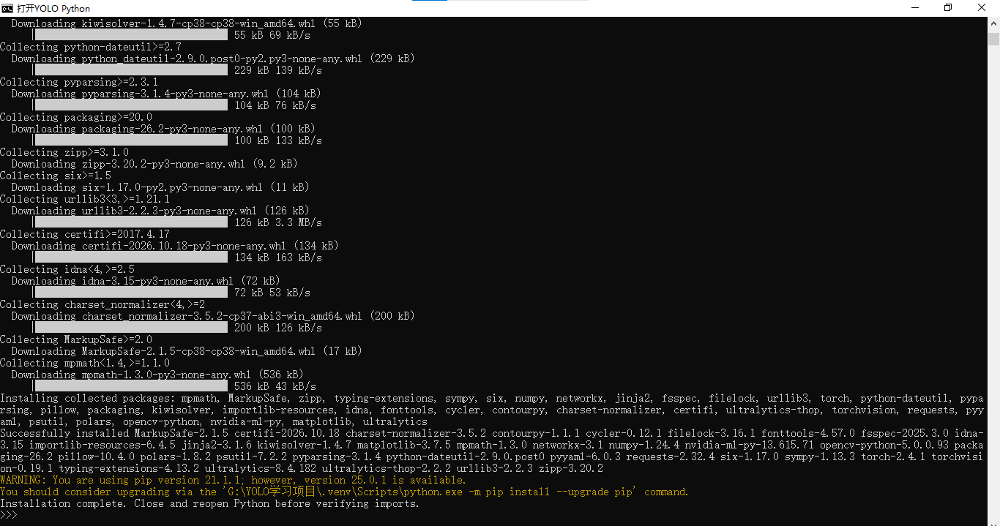
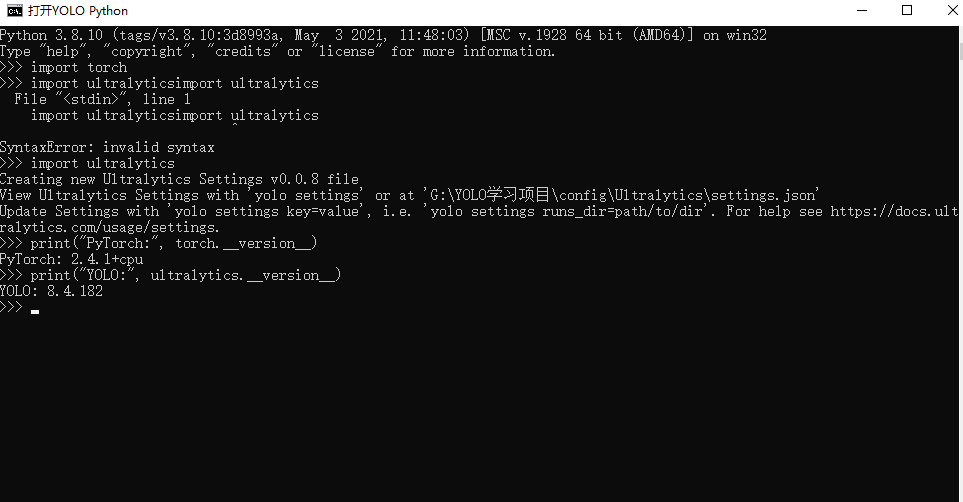

### 2.2 数据来源与检查

使用实验室仓库 main 分支的 obstacle、cola、football 原始图片，下载时固定到提交 `7600ea515c79aacde16f94885fd4d7fc1ace3556`。

| 原始分组 | 图片数 |
|---|---:|
| obstacle | 316 |
| cola | 293 |
| football | 340 |
| 合计 | 949 |

下载后检查结果为 0 张无法读取、0 组内容完全相同的重复图；948 张 640×480，1 张 640×400。精确重复检查不等于近似重复检查。原始来源清单和检查结果保存在 provenance/。

### 2.3 手工数据与划分

本人手工完成 63 张标签。按拍摄日期划分，7 月 25 日、27 日为训练集，7 月 28 日为验证集；不随机拆开同一天的相邻连拍。

| 划分 | 图片数 | obstacle 框 | cola 框 | football 框 | 合计框数 |
|---|---:|---:|---:|---:|---:|
| train | 51 | 25 | 22 | 54 | 101 |
| val | 12 | 10 | 7 | 6 | 23 |
| 合计 | 63 | 35 | 29 | 60 | 124 |

比例约 81%:19%。两个集合都包含三类目标，文件哈希检查没有完全相同的图跨集合。原图与原标签保持不变，dataset/ 内为副本。划分对应关系见 provenance/dataset_split.json。

**待补真实截图：**请本人在文件资源管理器中展开 dataset/images/train、val 与 dataset/labels/train、val，截图保存为 `results/screenshots/L1_04_数据集目录结构.png`。本报告不使用渲染目录图代替操作截图。

## 3. Level 2：手工目标标注

使用 LabelImg 的 YOLO 保存格式，类别顺序固定为 obstacle、cola、football。每张图的标签文件与图片同名，内容每行一个目标：

```text
class_id x_center y_center width height
```

后四项是相对于图片宽高的归一化比例。本人首张标注的实际示例：

```text
1 0.488281 0.484375 0.054688 0.243750
2 0.143750 0.386458 0.053125 0.031250
```

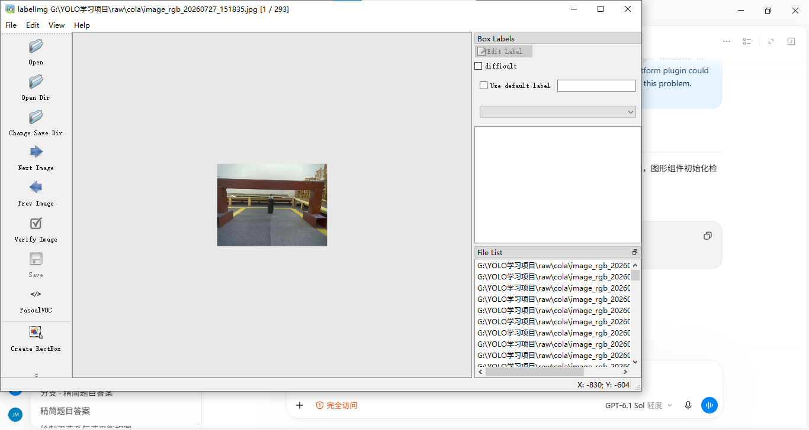
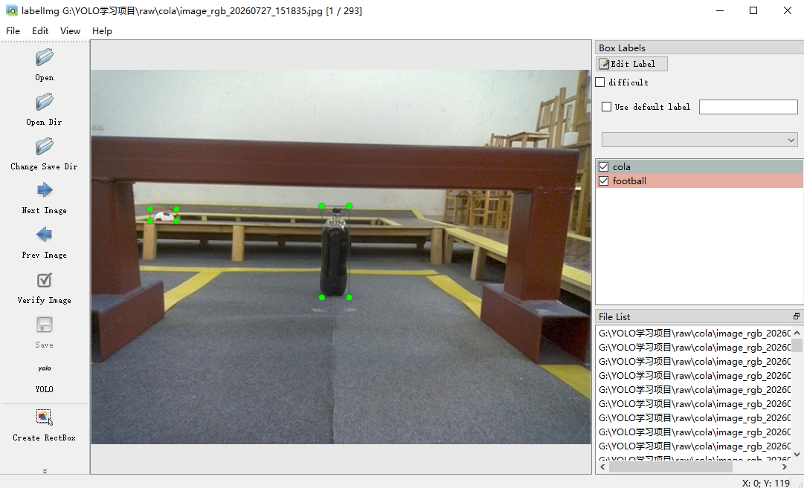
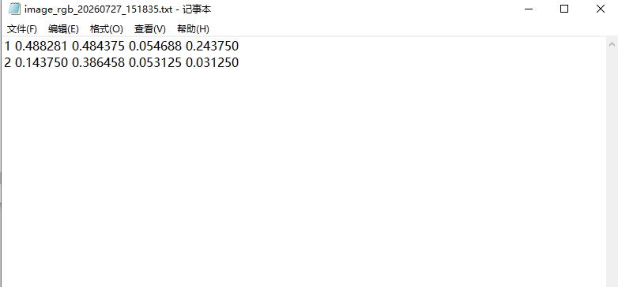
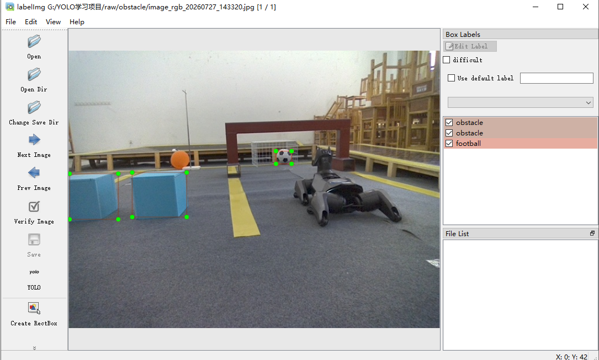

AI 提供操作说明、脚本和数字格式检查；本人判断标签内容并完成画框。曾试验过一批 AI 辅助标注，但未采纳，已移入本机错误回收文件夹；正式训练只用 annotations/ 中的 63 张手工标签，提交包不包含被弃用的 AI 标签和预览。

## 4. Level 3：模型训练与验证

### 4.1 参数与运行过程

用官方通用预训练 YOLO11n 权重初始化，先进行 1 轮试训练确认流程，再从初始化权重重新训练 30 轮。正式训练参数：

| 参数 | 设置 |
|---|---|
| epochs | 30 |
| imgsz | 640 |
| batch | 4 |
| device / workers | cpu / 0 |
| seed / deterministic | 42 / True |
| optimizer | auto（日志实际选择 Adam） |
| amp / cache | False / False |

训练耗时约 687 秒，即 11.5 分钟。没有使用回收目录中的文件。原实验脚本是 train_yolo.py；提交入口 train.py 保留核心训练参数，增加命令行与可移植路径处理，原脚本在 provenance/original_scripts/ 中。

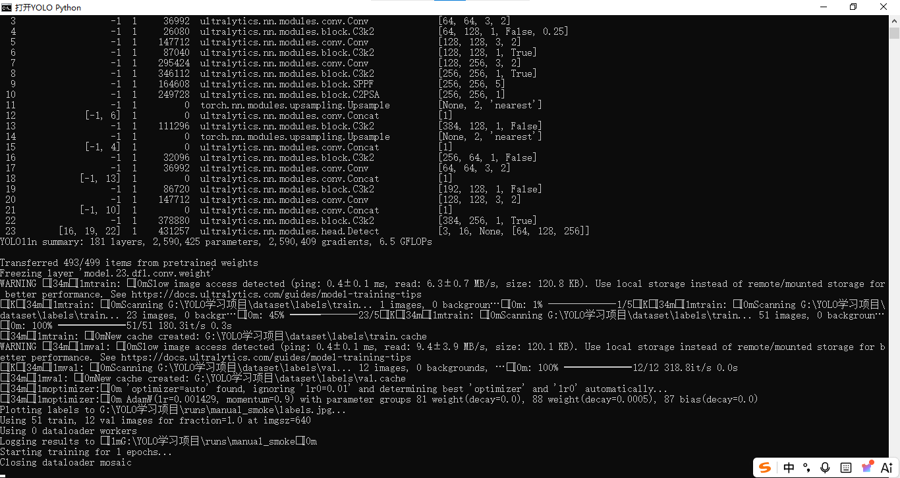
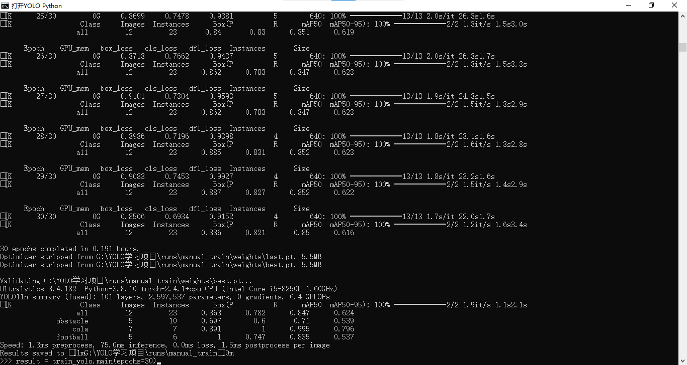

### 4.2 验证指标

以下是最佳权重最终验证时终端显示的指标（截图取值，已四舍五入）：

| 类别 | Precision | Recall | mAP50 | mAP50-95 |
|---|---:|---:|---:|---:|
| all | 0.863 | 0.782 | 0.847 | 0.624 |
| obstacle | 0.697 | 0.600 | 0.710 | 0.539 |
| cola | 0.891 | 1.000 | 0.995 | 0.796 |
| football | 1.000 | 0.747 | 0.835 | 0.537 |

以上来自 12 张验证图、23 个目标，不是 9 张新图的定量评估。训练检查点内保存的指标与最终重新验证阶段有小幅差异，原始 results.csv 与检查点均保留，不能把最后一轮 CSV 指标当作最终最佳模型指标。

Precision 描述检出的目标中正确目标的比例；Recall 描述标注目标被检出的比例；mAP 衡量不同召回水平下的检测表现，mAP50-95 使用更严格的一组位置重叠阈值。它们不能统称为“分类准确率”。

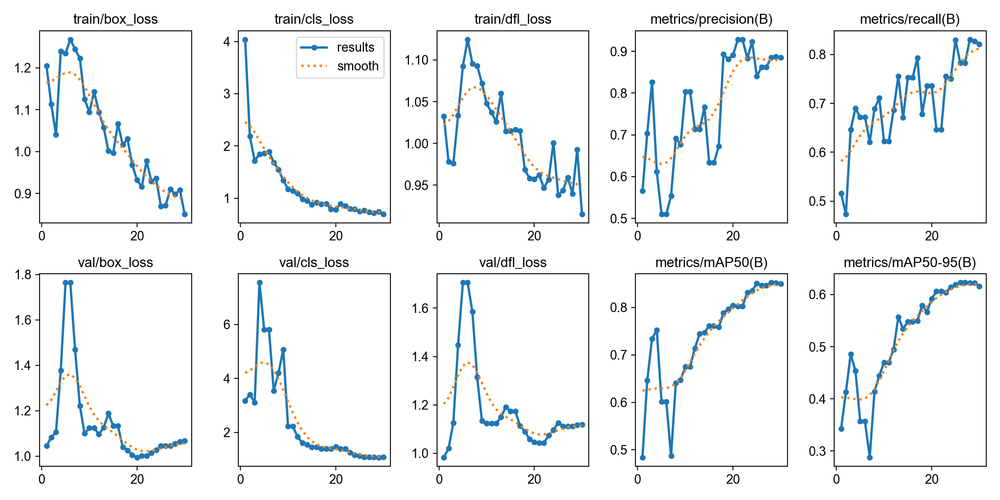
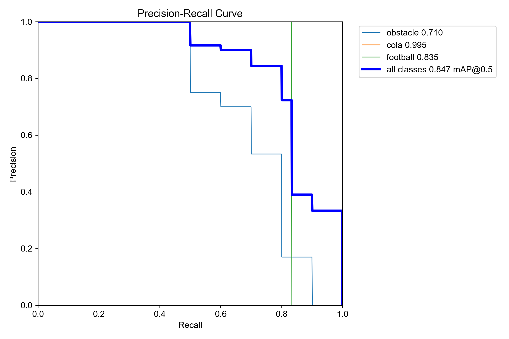
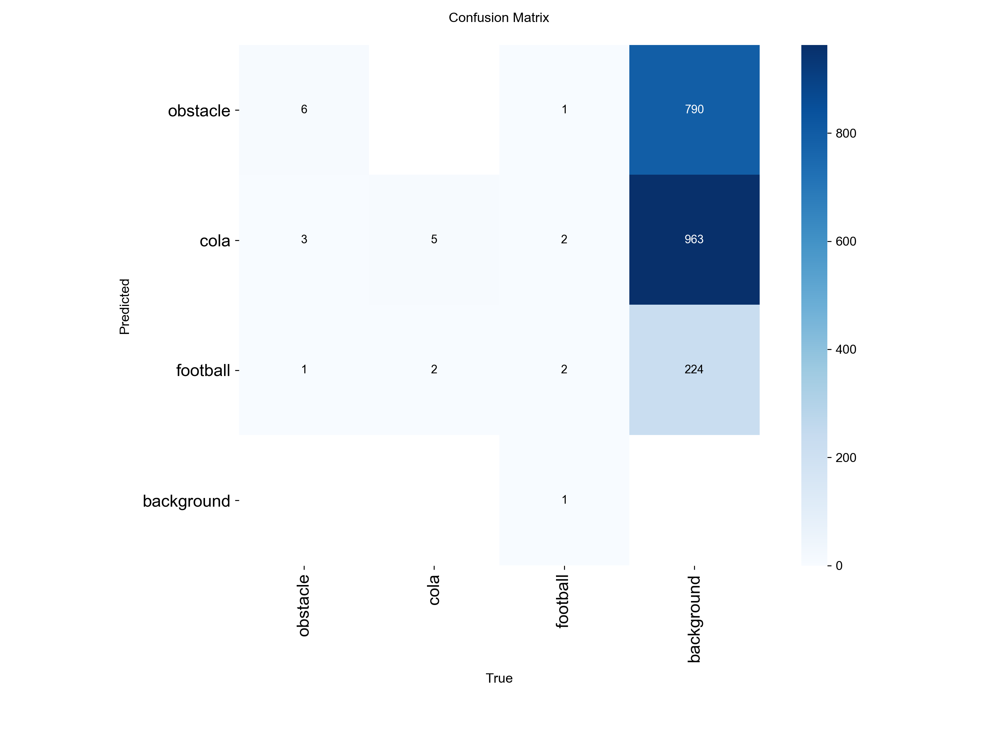

权重位置：`runs/manual_train/weights/best.pt` 与 `last.pt`，大小约 5.5 MB。完整 30 轮指标见 results.csv；args.yaml 保留原实验配置和本机路径作为证据，运行提交版时使用根目录 data.yaml。

## 5. Level 4：训练外图片检测

从剩余原始图片中另外选取 9 张，均未用于上述训练和验证，使用本人训练后的 best.pt，输入尺寸 640、置信度阈值 0.25、CPU 检测。按内容哈希排除了与训练/验证图的完全重叠，清单见 provenance/new_images_manifest.json。

这些图片仍来自同一实验室，与训练数据可能有近似场景；没有独立人工测试标签，故本节只展示定性检测效果，不报告新图准确率或测试 mAP，也不声称跨场景泛化已经验证。

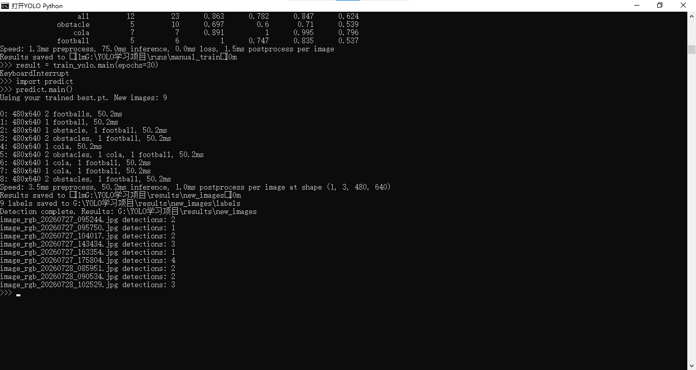

### 检测结果示例

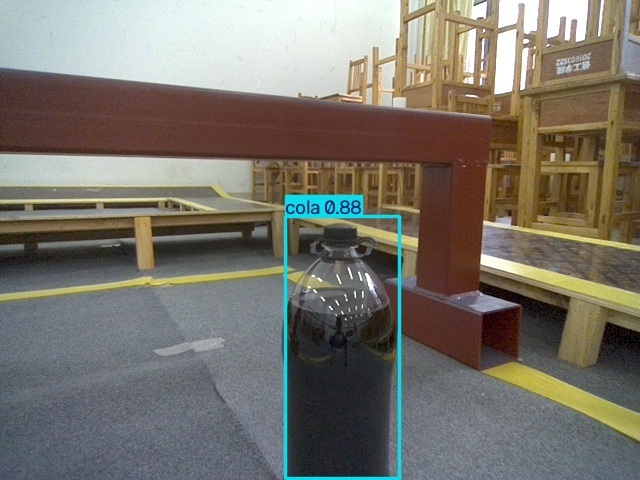
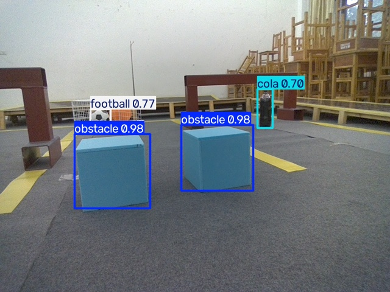
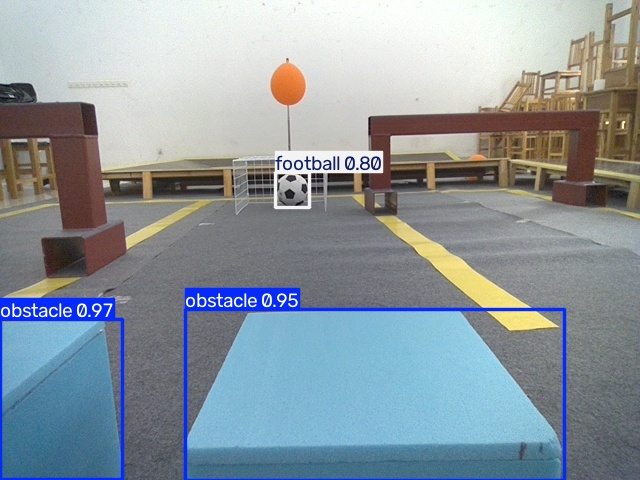

全部 9 张输入保存在 new_images/，带框结果保存在 results/new_images/，数字结果在该目录的 labels/ 中。每行依次为类别、归一化框坐标与置信度；该数字是模型置信度，不等于整体准确率。上述图片为模型实际检测输出，不是手工标注预览。

## 6. 遇到的问题与解决

| 问题 | 处理与理解 |
|---|---|
| 多条 Python 命令粘成一行而 SyntaxError | 逐行输入，每行按 Enter；重开窗口需重新 import |
| 旧版 pip 在代理连接时报 check_hostname 错误 | AI 辅助准备安装入口，适配当前代理的连接方案；缓存放 G 盘 |
| LabelImg 启动脚本中文路径编码错误 | 直接由项目 Python 运行独立启动文件，绕过错误入口 |
| Qt 无法发现 windows 平台插件 | 检查插件文件存在后，通过英文路径入口明确设置插件目录 |
| 预标注将橙色物体误作足球、漏掉大足球 | 弃用该批 AI 标签，改由本人手工标注，不将错误预览当训练成果 |
| 结果看起来没有检测框 | 区分 new_images 原始输入与 results/new_images 带框输出 |

安装报错原文与安装日志保存在 results/screenshots/ 的文本文件中。没有为了截图重建虚假的终端输出。

## 7. 限制与后续改进

目前只使用 63 张标注图，验证集也仅 12 张，三类实例数量不均衡；场景相似，验证分数可能偏乐观。尤其障碍物和足球存在漏检风险，应继续采集不同背景、光照、视角与遮挡图片，扩大手工标注和独立测试集。增加训练轮数并不必然解决泛化问题，先改善数据覆盖更有意义。

AI 辅助提供命令、编写和解释脚本、处理安装问题、整理报告；本人完成画框、在本机启动训练与推理并提供真实截图。提交代码由 AI 协助整理为可移植入口，本人已进行基础问答学习，主要参数、路径和权重的细节仍需继续深入理解。

## 8. 本人总结

以下总结由 AI 根据本人的实际问答整理。

我最希望理解的是 AI 视觉模块的原理。我初步认识到，YOLO 会根据图片与标注学习特征，不能只通过告诉它“可乐是黑色的”就完成训练。模型学到的判断方式也不一定与人相同，颜色只是可能使用的线索之一。

我亲自使用 LabelImg 画框，并在本机运行训练和检测。曾经的 AI 预标注将橙色物体认成足球、漏掉大足球，我决定弃用那批结果，改用自己手工标注的数据。陌生代码、环境操作和报告整理由 AI 协助，标注与实际实验由我完成。

我认识到分数升高只能说明初步训练有效，不能证明模型在所有环境中都可靠。不同光照和背景可能改变物体外观，下一步应加入不同环境的数据，并用没有参加训练的图片验证。只增加轮数不能保证改善结果，还需要关注过拟合和漏检。

在讨论中，我练习了 Precision、Recall 和 IoU 的计算，理解了避障任务中漏检可能造成碰撞，而误报可能让机器人频繁停止。我对训练参数、批次、权重文件以及类别编号和配置文件之间的对应关系仍不够熟练，后续将继续结合自己的代码学习。Level 5 留待后续开展。

## 9. 参考与任务依据

- [仓库总说明](https://github.com/SDNURoboticsAILab/2026AutumnEngineeringChallenges/blob/main/README.md)
- [YOLO 任务要求](https://github.com/SDNURoboticsAILab/2026AutumnEngineeringChallenges/blob/main/YOLO/README.md)
- [Ultralytics 文档](https://docs.ultralytics.com/)
- [LabelImg](https://github.com/HumanSignal/labelImg)

整理目录时参考 PR #54 的分级成果组织和 PR #14 的图文报告结构，仅参考形式，未复制其他同学的代码、标签、截图和指标。其他同学采用的划分比例、轮数或网页扩展不作为本项目的硬性要求。
